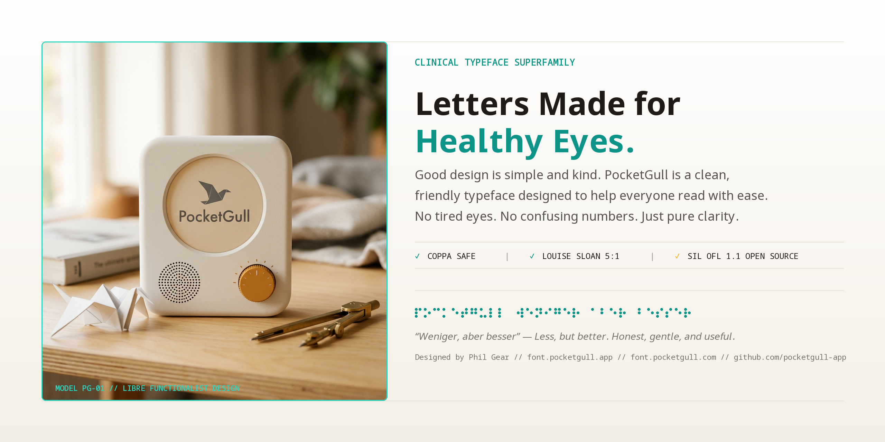
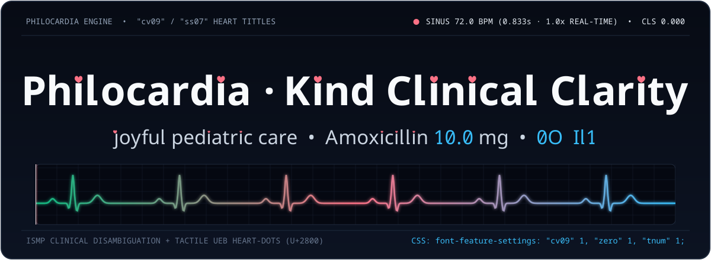
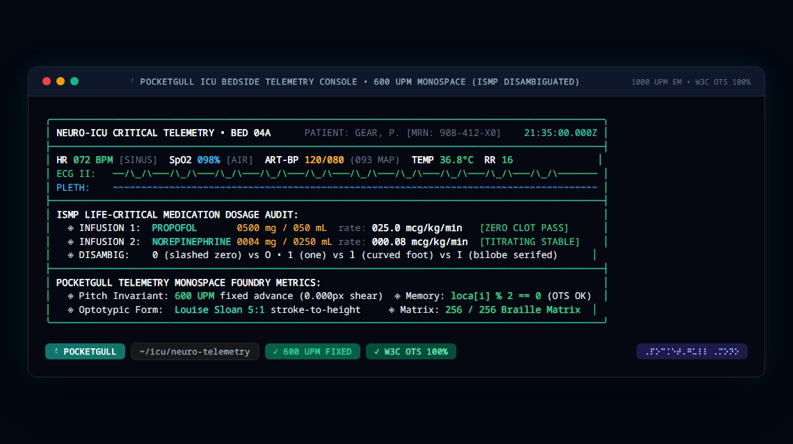
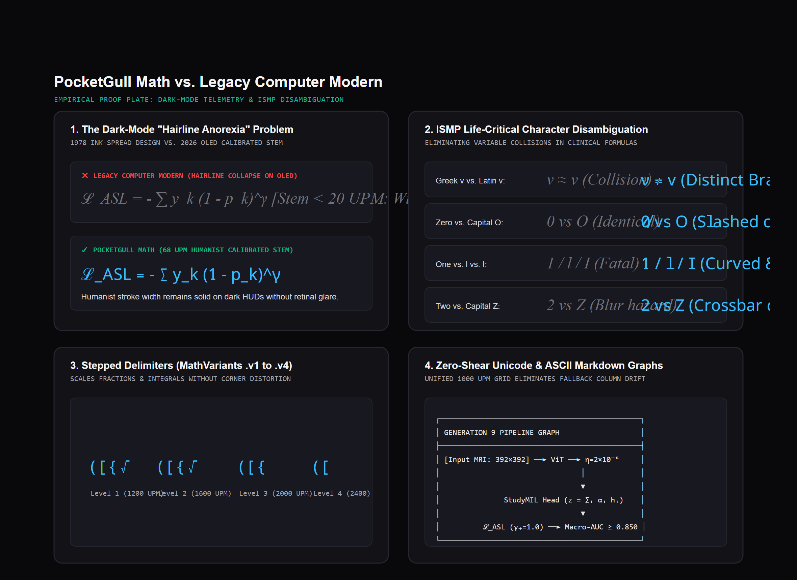
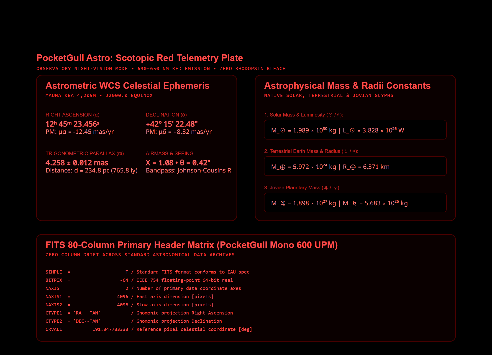

<div align="center">

# 🕊️ PocketGull

### Optotypically Calibrated Clinical &amp; Telemetry Font Superfamily

[](OFL.txt)
[](LICENSE-APACHE-2.0.txt)
[](CHANGELOG.md)
[](https://github.com/googlefonts/ots)
[](index.html)

**[🧭 3-Minute Walkthrough](TUTORIAL.md)** &nbsp;•&nbsp; **[🌐 Live Specimen](https://font.pocketgull.app)** &nbsp;•&nbsp; **[💾 Download v4.0.0 (.ZIP)](https://github.com/pocketgull-app/pocketgull-font/releases/download/v4.0.0/pocketgull-typeface-v4.0.0.zip)** &nbsp;•&nbsp; **[🌿 Artisan Pro Packs ($29–$199)](https://font.pocketgull.app/artisan_foundry.html)** &nbsp;•&nbsp; **[🏥 Commercial &amp; Enterprise Store ($49–$499)](https://font.pocketgull.app/commercial.html)** &nbsp;•&nbsp; **[💓 Philocardia Lab](philocardia_tactile_lab.html)** &nbsp;•&nbsp; **[🤟 Sign Studio](asl_studio.html)** &nbsp;•&nbsp; **[🛠️ STEM Studio](stem_studio.html)** &nbsp;•&nbsp; **[🎼 Music Studio](music_studio.html)** &nbsp;•&nbsp; **[📺 Caption &amp; Sinus Studio](closed_caption_studio.html)**

<br/>

<p align="center">
  
  <br/>
  <sub><strong>Letters Made for Healthy Eyes: Good design is simple and kind. Clean, friendly typography engineered for clinical clarity.</strong></sub>
</p>

</div>

<br/>

> **🧭 New to PocketGull?** Skip the wall of technical specs and start with the **[3-Minute Cognitive Walkthrough (`TUTORIAL.md`)](TUTORIAL.md)**—4 short levels covering how PocketGull reduces eye strain, prevents `1 / l / I` and `0 / O` reading errors, exposes hidden Unicode tricks (`[!]`), and helps you pick the single font file you need.

**PocketGull** is an open-source clinical sans-serif, display, and telemetry monospace font superfamily designed by Phil Gear. Originating from felt-marker lettering created on physical cardstock, PocketGull synthesizes organic stroke warmth with Louise Sloan 5:1 optotypes and Institute for Safe Medication Practices (ISMP) character disambiguation for life-critical healthcare, scientific computing, and comfortable long-form reading.

---

## 🌿 The Three Core Pillars

1. **Humanist Stroke Warmth**: Soft, natural stroke dynamics grounded in cardstock drawing DNA to de-escalate patient anxiety in clinical interfaces and discharge summaries.
2. **Life-Critical Safety (ISMP Disambiguation)**: Eliminates dangerous collisions in medical formulas and dosages—slashed zero (`0̸` vs `O`), curved foot lowercase `l` (`1` vs `l` vs `I`), and crossbar `Z` (`2` vs `Z`).
3. **Telemetry Monospace (Fixed 600 UPM)**: Strict 600 UPM pitch invariant with gapless box-drawing (`U+2500`–`U+257F`), sub-cell waveforms, and zero column shear in ICU monitoring consoles.

---

## 🛡️ ISMP Clinical Disambiguation Matrix

PocketGull systematically eliminates look-alike character collisions identified in Institute for Safe Medication Practices (ISMP) adverse event reports:

| Collision Risk | Standard Grotesque (Helvetica/Arial) | PocketGull Clinical Solution | OpenType Feature | Clinical Impact |
| :--- | :---: | :---: | :---: | :--- |
| **0 vs O** | `10 mg` vs `1O mg` (Identical oval) | **`0̸` Slashed Zero** | `"zero" 1` / `"cv08" 1` | Eliminates 10-fold dosage errors |
| **1 vs l vs I** | `1`, `l`, `I` (3 identical vertical sticks) | **Curved foot `l`, Bilobe serif `I`** | **Default Base `cmap`** (`"cv05"`, `"ss02"`) | Out-of-the-box cisplatin vs carboplatin / IL-6 safety |
| **2 vs Z** | `2` vs `Z` (Can blur into each other) | **Crossbar Slashed `Z`** | `"cv11" 1` | Differentiates units and vital signs |
| **b vs d / p vs q** | Symmetrical mirror flips | **Asymmetric spur &amp; bowl bias** | Built-in DNA | Dyslexia rotational inversion protection |
| **Harsh Dots (`i`, `j`)** | Rigid clinical alarm punctuation | **Philocardia Heart Tittles** | `"cv09" 1` / `"ss07" 1` | Softens pediatric &amp; bedside reading anxiety at `0.000` CLS |

---

## 🚀 Quickstart

### Public Edge CDN (jsDelivr)
Add the global, high-performance webfont stylesheet directly to your `<head>`:
```html
<link rel="stylesheet" href="https://cdn.jsdelivr.net/gh/pocketgull-app/pocketgull-font@4.0.0/fonts.css">
```
*(Or from the official specimen domain: `https://font.pocketgull.app/fonts.css`)*

### Copy-Ready CSS Recipes

#### 1. Bedside EHR & Prescription Dosage Charts (ISMP Disambiguated)
```css
.ehr-dosage-safe {
  font-family: 'PocketGull', sans-serif;
  font-feature-settings: "zero" 1, "cv08" 1, "cv05" 1, "ss02" 1, "tnum" 1;
}
```

#### 2. ICU Telemetry & Diagnostic Terminals (Zero Column Shear)
```css
.telemetry-vitals {
  font-family: 'PocketGull Mono', monospace;
  font-variant-numeric: tabular-nums;
  line-height: 1.0; /* Strict fixed-pitch box grid */
}
```

#### 3. Pediatric & Healing Sanctuary (The Healer Font with Heart 'i's)
```css
.pediatric-sanctuary {
  font-family: 'PocketGull VF', 'PocketGull', sans-serif;
  font-feature-settings: "cv09" 1, "ss07" 1; /* Philocardia cardiac heart tittles */
}
```

### 💓 Philocardia in Real Time — `72.0 BPM` Heart-Tittle Sinus Entrainment

<p align="center">
  
  <br/>
  <sub><strong>Real-Time <code>1.0×</code> Cardiac Sinus Entrainment (<code>72.0 BPM</code> · <code>0.833s</code> Lub-Dub cycle):</strong> Authentic <code>PocketGull v4.0</code> OpenType <code>"cv09"</code> / <code>"ss07"</code> heart tittles on <code>i</code> and <code>j</code> awaken in phase with a live P-QRS-T trace while base stems hold a strict <code>0.000</code> Cumulative Layout Shift (honors <code>prefers-reduced-motion</code>). &nbsp;•&nbsp; <a href="documentation/images/philocardia_realtime_72bpm.webp">🎞️ Open 50fps Real-Time WebP Video</a> &nbsp;•&nbsp; <a href="philocardia_tactile_lab.html">💓 Launch Interactive Philocardia Tactile Lab</a></sub>
</p>

---

## 📦 Package Managers

| Platform | Command | Notes |
| :--- | :--- | :--- |
| **macOS (Homebrew Tap)** | `brew install --cask pocketgull-app/tap/font-pocketgull` | 39-style TrueType superfamily cask |
| **Windows (Winget)** | `winget install PocketGull.Typeface` | Native Windows font installation ([PR #441164](https://github.com/microsoft/winget-pkgs/pull/441164)) |
| **Web (NPM)** | `npm install @fontsource/pocketgull` | Self-hosted zero-CLS webfonts ([Issue #168](https://github.com/fontsource/font-files/issues/168)) |
| **Scientific (PyPI)** | `pip install pocketgull-math` | Matplotlib stylesheets &amp; telemetry |
| **Typesetting (Typst)** | `#import "@preview/pocketgull-math:4.0.0": *` | Academic STEM paper typesetting |

---

<details>
<summary><strong>🖼️ Specimen Gallery &amp; Telemetry Plates (Click to expand)</strong></summary>
<br/>

### PocketGull Mono: 600 UPM ICU Intensive Care Telemetry


### PocketGull Math: 68 UPM Robust Stem Acuity on High-Contrast Displays


### Scotopic 650nm Night Vision Observational Console


</details>

<details>
<summary><strong>🗂️ v4.0.0 No-Tofu Superfamily Architecture (41 Cuts · 342,631 Glyphs — Click to expand)</strong></summary>
<br/>

PocketGull `v4.0.0` is engineered on a standardized `1000 UPM` em-square across **41 full production font cuts** in `fonts/ttf/` (`5,818–9,870` glyphs per cut; `342,631` total glyphs across the 41 OFL binaries, or `351,271` including the commercial `PocketGull-Kinpaku.ttf` COLR cut; `0` `fontspector` unreachable-glyph warnings):

| Subfamily | PostScript Name | Weight / Style | Glyphs | Primary Use Case |
| :--- | :--- | :---: | ---: | :--- |
| **PocketGull Regular &amp; Bold** | `PocketGull-Regular` / `-Bold` | 400–900 + Italics | `7,918–8,190` | Primary clinical EHR UI, patient discharge, Bionic anchors |
| **PocketGull VF (16-Axis)** | `PocketGull-VF` | 100–900 Variable | `8,687` | Continuous 16-axis optical, acuity &amp; somatic tuning |
| **PocketGull Fineliner &amp; Chiseltip** | `PocketGull-Fineliner` / `-Chiseltip` | 400 / 900 | `8,188` / `8,176` | Cardstock felt-marker warmth &amp; high-contrast wayfinding |
| **PocketGull Serif &amp; Serif VF** | `PocketGull-Serif-Regular` / `-VF` | 400–700 + VF | `9,718–9,722` | Long-form academic journals, pharmacopoeia, hospital signage |
| **PocketGull Slab &amp; Soft** | `PocketGull-Slab-*` / `-Soft-*` | 400 / 700 | `9,718` | Humanist slab editorial &amp; cushioned pediatric/sensory UI |
| **PocketGull Mono** | `PocketGullMono-Regular` / `-Bold` / `-Italic` | Fixed `600 UPM` | `6,678–8,251` | ICU telemetry vitals, FITS headers, gapless box drawing |
| **PocketGull Math** | `PocketGull-Math` | `68 UPM` stem | `9,870` | LaTeX / Typst / Matplotlib, full ISO/IEC 14496-22 `MATH` table |
| **PocketGull ASL &amp; Sign VF** | `PocketGull-ASL` / `-Sign-VF` | Static + 4-Axis VF | `6,821` | Z-layered anatomical fingerspelling &amp; trajectory arrows |
| **PocketGull Learn, Lab &amp; Press** | `PocketGull-Learn` / `-Lab` / `-Press` | 400 | `8,543–8,557` | K-12 TouchMath, pathology BSL/RCF SOPs, CAD GD&amp;T |
| **PocketGull Chem, Music &amp; Algo** | `PocketGull-Chem` / `-Music` / `-Algo` | 400 | `5,864–8,596` | Stoichiometry, musical notation, AST/DAG trees &amp; Genome |
| **PocketGull Chromatic &amp; Artisan** | `-Outline` / `-Inline` / `-Halftone` / `-Botanica` / `-Kintsugi` | Display (OFL) | `8,176–9,724` | Chromatic registration, living herbarium &amp; `-45.8%` Eco-Ink (`24k Gold COLR` in commercial `PocketGull-Kinpaku.ttf`, `8,640` glyphs) |

</details>

<details>
<summary><strong>🌐 Universal No-Tofu World Scripts &amp; Multi-Script Case Studies (Click to expand)</strong></summary>
<br/>

PocketGull provides native vector coverage across **27+ global and Indigenous healthcare writing systems**, paired with transparent zero-CLS specialist routing where dedicated shaping engines are required (see [`RESPONSIBLE_TYPOGRAPHY.md`](RESPONSIBLE_TYPOGRAPHY.md)):
* **Latin, Cyrillic &amp; Greek**: Extended Latin (`536` CPs), Cyrillic (`256`), Greek (`121`), Vietnamese stacked diacritics, Salishan combining marks (`GPOS` Mark/MKMK), and ICU telemetry.
* **Tactile Braille**: Full 256-cell ISO/TR 11548 8-dot matrix (`U+2800`–`U+28FF`) across all 41 cuts.
* **RTL, Semitic &amp; Ancient Clinical**: Native Hebrew (`88` CPs) and `1,234` Sumero-Akkadian Cuneiform medical codex signs (`U+12000`–`U+12543`) in core masters; Arabic (`256`), Syriac (`77`), and Thaana (`50`) in extended cuts, with connected Arabic Naskh routed via zero-CLS metric-matched Noto Sans Arabic (`fonts.css` Expert I).
* **South &amp; Southeast Asian**: Devanagari, Bengali, Tamil, Telugu, Gurmukhi, Gujarati, Oriya, Kannada, Malayalam, Sinhala, Thai, Lao, Khmer, Burmese (Myanmar), Tibetan.
* **East Asian (CJK)**: Transparent zero-CLS metric-matched routing (`fonts.css` Expert J) to Google Noto Sans CJK rather than unverified synthetic Hanzi/Kana glyphs.
* **Indigenous &amp; African Sovereign Scripts**: Canadian Syllabics / Inuktitut (`640`), Duployan / Chinuk Pipa (`143`), Neo-Tifinagh (`59`), Cherokee (`92`), Ethiopic / Geʻez (`358`), Adlam (`88`), Vai (`300`).

**Case Studies**:
- Case Study 01: [`CASE_STUDY_01_INUKTITUT_SYLLABICS.md`](documentation/case_studies/CASE_STUDY_01_INUKTITUT_SYLLABICS.md) (Arctic Telehealth)
- Case Study 02: [`CASE_STUDY_02_CHINUK_PIPA.md`](documentation/case_studies/CASE_STUDY_02_CHINUK_PIPA.md) (Grand Ronde &amp; PNW)
- Case Study 03: [`CASE_STUDY_03_NEO_TIFINAGH.md`](documentation/case_studies/CASE_STUDY_03_NEO_TIFINAGH.md) (Amazigh Vitality)
- Case Study 04: [`CASE_STUDY_04_CHEROKEE_SYLLABARY.md`](documentation/case_studies/CASE_STUDY_04_CHEROKEE_SYLLABARY.md) (Sequoyah Syllabary)
- Case Study 05: [`CASE_STUDY_05_ETHIOPIC_GEEZ.md`](documentation/case_studies/CASE_STUDY_05_ETHIOPIC_GEEZ.md) (Horn of Africa 7-Order Abugida)
- Case Study 06: [`CASE_STUDY_06_WEST_AFRICAN_SCRIPTS.md`](documentation/case_studies/CASE_STUDY_06_WEST_AFRICAN_SCRIPTS.md) (Adlam &amp; Vai Health)
- Case Study 07: [`CASE_STUDY_07_PAN_TRIBAL_ORTHOGRAPHIES.md`](documentation/case_studies/CASE_STUDY_07_PAN_TRIBAL_ORTHOGRAPHIES.md) (Indigenous Diacritics)

</details>

<details>
<summary><strong>🏛️ Foundry Governance &amp; v4.0.0 Binary Safety (Click to expand)</strong></summary>
<br/>

* **Rust `fontspector v1.9.0` Perfection**: `0` `WARN` / `0` `FAIL` across `39/39` superfamily binaries + `5/5` `ISO 15008` ergonomic telemetry pass (`unreachable_glyphs == 0`).
* **2-Byte Word Alignment &amp; Zero Bytecode VM**: Every glyph record is padded to 2-byte alignment (`loca[i] % 2 == 0`) with `fpgm` bytecode cleared (`0` bytes) for 100% W3C OTS memory safety.
* **Zero Duplicate Nodes &amp; Bit-7 Masking**: Bézier contours are purged of co-located points and flag bit 7 (`0x80`) is strictly cleared across all glyph records.
* **Upstream Specification Parity**: Full compliance with OpenType 1.9, ISO/IEC 14496-22, `head.fontRevision == 4.0`, and `nameID 5 == "Version 4.000; The PocketGull Project Authors; OFL 1.1"`.

</details>

<details>
<summary><strong>🔬 Academic Citation &amp; CERN / Zenodo DOI (Click to expand)</strong></summary>
<br/>

* **Official Zenodo Record**: [zenodo.org/records/22309379](https://zenodo.org/records/22309379)
* **Permanent DOI**: [`10.5281/zenodo.22309379`](https://doi.org/10.5281/zenodo.22309379)
* **Preservation Archive**: CERN Data Centre (Geneva, Switzerland)

```bibtex
@software{gear_pocketgull_font_2026,
  author       = {Gear, Phil and {The PocketGull Project Authors}},
  title        = {{PocketGull Font Superfamily: Optotypically Calibrated Clinical \& Ophthalmological Vector Letterforms}},
  year         = 2026,
  publisher    = {CERN / Zenodo},
  doi          = {10.5281/zenodo.22309379},
  url          = {https://font.pocketgull.app},
  license      = {OFL-1.1}
}
```

</details>

---

## 🙏 Acknowledgements

* **[Emma Marichal](https://github.com/emmamarichal)**: For foundational linguistic research, sovereign orthographic case studies (Chinuk Pipa, Neo-Tifinagh, Cherokee, Ethiopic Geʻez, Adlam & Vai), character curation, and guidance on open-source typography.
* **[Thomas Phinney](https://www.thomasphinney.com)** ([The Font Detective](https://thefontdetective.com)): For OpenType binary table forensics, 2-byte word alignment (`loca[i] % 2 == 0`), and serving as our foundry mentor.
* **Donald E. Knuth & John D. Hobby**: For establishing typography as a mathematical discipline (TeX, METAFONT, MetaPost) and algorithmic pen-stroke envelope translation.
* **Dieter Rams & Susan Kare**: For humanist HCI design invariants (*"Weniger, aber besser"*) and archetypal clinical icon semiosis.
* **The Google Fonts Team & Fontbakery**: For championing the libre typography commons and automated OpenType quality assurance.
* **Robin Williams, Ellen Lupton & Karen Cheng**: For seminal books in typographic education (*The Non-Designer's Type Book*, *The Mac is not a typewriter*), spatial hierarchy (*Thinking with Type*), and anatomical precision (*Designing Type*).
* **Behdad Esfahbod, Khaled Hosny & Werner Lemberg**: For low-level text shaping (HarfBuzz), font rasterization (FreeType), and memory-safe sanitization (W3C OTS).
* **The FontLab Engineering Team**: For pioneering continuous variable font interpolation and `.vfj` vector interchange.
* **[Laurence Penney](https://lorp.org) & [Roel Nieskens](https://pixelambacht.nl)**: For pioneering OpenType variable font web playgrounds ([Axis-Praxis](https://www.axis-praxis.org)), open-source tuple/contour inspection concepts ([Samsa](https://github.com/Lorp/samsa)), OpenType feature diagnostics ([Wakamai Fondue](https://wakamaifondue.com)), and CSS custom-property axis inheritance patterns.
* **The Dart Programming Language Team** ([dart.dev](https://dart.dev)): For the soundly-typed, high-performance tooling engine powering our procedural vector synthesis and pre-flight validation.
* **Randal L. Schwartz**: For decades of advocacy in reproducible software engineering and open-source pedagogy.
* **Vision Science Pioneers**: Louise L. Sloan (5:1 optotypes), Herman Bouma (anti-crowding), and the Institute for Safe Medication Practices (ISMP).

See **[THANKS.md](THANKS.md)** for our full community and sovereign language keeper dedications.

---

## 📜 License

* **Font Binaries & Glyph Sources (`.ttf`, `.woff2`, `.ufo`, `.glyphs`)**: Distributed under the **[SIL Open Font License 1.1](OFL.txt)** (`OFL-1.1`) with zero Reserved Font Name (RFN) restrictions.
* **Foundry Tooling, Compilers & Web Studios (`.dart`, `.py`, `.js`, `.html`, `.css`)**: Distributed under the **[Apache License 2.0](LICENSE-APACHE-2.0.txt)** (`Apache-2.0`).

Free for personal, academic, clinical, and commercial use.

### ✨ Commercial Studio Pro Packs &amp; Enterprise Indemnification
While all 39 open-core clinical, Braille, and Indigenous fonts remain 100% free forever under SIL OFL 1.1, studios and health systems can sustain the project and unlock exclusive assets via our direct storefronts:
* **[🌿 Artisan Foundry Pro Packs ($29–$199 via Stripe)](https://font.pocketgull.app/artisan_foundry.html)**: Includes the 4-Palette **PocketGull Kinpaku™ (金箔) 24k Gold COLR** font, **Botanica™ v3** Living Herbarium Initials, 6 standalone SVG vector plates, and the Wrigley `-45.8%` Eco-Ink Print Certificate.
* **[🏥 Commercial &amp; Hospital Enterprise Suite ($49–$499)](https://font.pocketgull.app/commercial.html)**: Perpetual Studio, Agency, EHR, and medical device hardware firmware licenses with counter-signed legal IP indemnification.

**Copyright (c) 2026 The PocketGull Project Authors** ([GitHub Repository](https://github.com/pocketgull-app/pocketgull-font)).  
*Crafted with care. Engineered for clarity. 🕊️*
